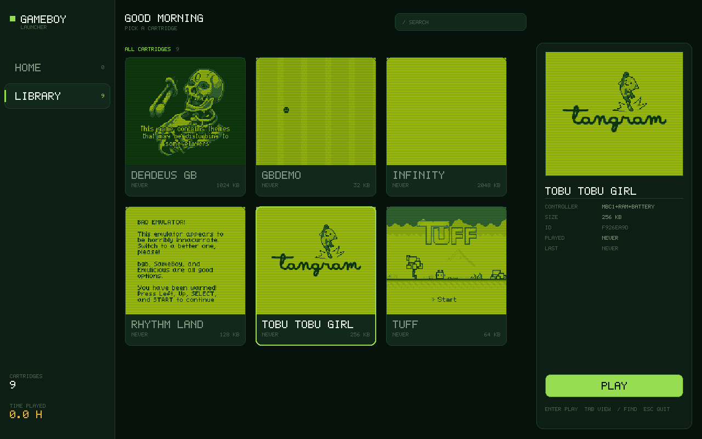

# gameboy

[](https://github.com/KRISH123no/gameboy/actions/workflows/ci.yml)

**A Game Boy, in Python, from nothing.** A cycle-counted CPU, a scanline graphics chip, cartridge
bank switching, a launcher, a disassembler and a stepping debugger. No runtime dependencies —
pygame only if you want a window.



```bash
pip install -e ".[dev,play]"

python -m gameboy launch                    # the launcher, above
python -m gameboy launch --roms ~/roms      # point it at a folder
python -m gameboy run tobu.gb               # straight into one cartridge
python -m gameboy demo                      # the built-in cartridge
python -m gameboy screenshot --frames 120 --out frame.png
python -m gameboy debug                     # step through instructions
```

## Does it run real games?

Yes. These are three homebrew cartridges, unmodified, running on this emulator:


I tested it against eight freely distributable homebrew games. **Seven run.** The eighth,
*Infinity*, does not — and the reason is worth stating precisely, because "it doesn't work" and
"it cannot work" are different claims. Infinity asks for the Game Boy Color's double-speed mode
and then waits in a loop until the speed has changed. From its own published source:

```asm
ai_fm_tryagain:                        ; Try to set FAST mode
   LD    A, #0x01
   LDH   (P_KEY1), A                   ; Causes 1x <-> 2x toggle
   STOP
   LDH   A, (P_KEY1)                   ; Is CPU 2x speed?
   ADD   A, A
   JR    NC, ai_fm_tryagain
```

There is no check anywhere for what machine it is running on. This emulator is an original Game
Boy, which has no double-speed mode and no KEY1 register, so that loop can never finish. Rather
than show a white screen and look broken, the emulator notices the KEY1 write and says *this
cartridge needs a Game Boy Color* across the display.

One more honest note: *Rhythm Land* ships a deliberate accuracy check, decides this emulator is not
good enough, and tells you so in as many words — "BAD EMULATOR!" You can see it on its cover in the
screenshot above, because the cover art is generated by actually booting the cartridge. Holding
Left, Up, Select and Start gets past it, and the game plays. It is right to complain: see
`mem_timing` below.

## How accurate is it, exactly?

Two independent checks, both reproducible, neither of them mine.

**Every opcode, against [SingleStepTests/sm83](https://github.com/SingleStepTests/sm83).** That
suite has a file per opcode and a thousand randomised cases in each: a complete starting CPU and
memory state, the exact state afterwards, and the bus activity for every machine cycle.

```
497,994 / 499,994 cases pass across 500 opcodes
```

Not just the results — the cycle counts and the order of every memory access too. The two opcodes
not in that figure are `HALT` and `STOP`, which the suite models as fixed three-cycle instructions
and this emulator implements from the hardware decision tree instead. More on that below.

```bash
python tools/opcode_conformance.py --download   # ~160 MB of JSON, once
python tools/opcode_conformance.py
```

**blargg's test ROMs**, which are what emulators have been graded on for twenty years. They write
their verdict to the serial port, or to the screen:

| Test | Result |
|---|---|
| `cpu_instrs` | **11 / 11 pass** — every instruction group |
| `instr_timing` | **pass** |
| `halt_bug` | **pass** |
| `mem_timing` | **fail** — `01:01 02:01 03:01` |

`mem_timing` is the honest gap. It checks *when within an instruction* a memory access lands, and
this emulator advances the graphics chip and the timer once per instruction rather than once per
cycle. There is a `fine_grained=True` switch that moves to per-access stepping, and it is not
enough on its own — the accesses would also have to be ordered correctly inside each instruction.
That is the next real piece of work, and it is the reason Rhythm Land complains.

## The launcher

`python -m gameboy launch` finds your `.gb` files and lays them out. Arrow keys move, `tab` swaps
Home and Library, `/` searches, enter plays, escape comes back.

**The cover art is not artwork.** There are no cover images for homebrew Game Boy games, so each
card is made by booting the cartridge for a few hundred frames and keeping the most interesting
frame it produced — scored by how far it is from a flat colour and how many of the four shades it
uses, which picks out a title screen and rejects the black frames on either side of it. It is the
emulator drawing its own icons. The results are cached under `~/.gameboy/covers`, keyed by a hash
of the ROM, so the first run takes a moment and every run after it is instant.

The whole interface, including the launcher, is drawn with a hand-written 5×7 bitmap font.
Rendering a normal font at eight pixels and scaling it up does not make pixel art, it makes a
blurred small font: strokes land between pixels and antialiasing turns them grey. Written out as
bits, every stroke is one pixel wide and lands exactly where it was put, at any scale.

The console's own menu (`python -m gameboy menu`) is a different thing deliberately: it is drawn at
160×144, in four shades, and scaled up with the game, so it reads as part of the handheld rather
than a dialog bolted to the front of it.

## What's inside

| | |
|---|---|
| **CPU** | The Sharp LR35902. All 512 opcodes including the CB-prefixed set, interrupts with correct priority and timing, the HALT bug, and the four-way STOP |
| **Graphics** | Scanline renderer: background, window, sprites with flipping and priority, the ten-sprite-per-line limit, the mode timing games depend on |
| **Cartridges** | Header parsing with checksum, and MBC1, MBC3 and MBC5 bank switching, so ROMs up to 2 MB work |
| **Memory** | The full map, including echo RAM, OAM DMA, and the registers a DMG does *not* have |
| **Timer** | DIV and the programmable timer, driven off counter edges rather than division |
| **Input** | The eight buttons, on the two-group selector the hardware uses |
| **Launcher** | Cover art generated from the cartridges, search, and play history |
| **Tools** | A disassembler, a stepping debugger with breakpoints, PNG and terminal output |

## Two decisions worth defending

**Nothing is decoded from a table of 512 entries.** The instruction set is laid out on a bit
pattern — `xxyyyzzz`, where `z` usually picks a register and `y` an operation — so eight families
of instructions are eight small blocks of code instead of four hundred branches. The disassembler
is written from the same decoding, which means the two cannot drift: if an opcode executes, it
disassembles.

**Cycle counts are not read from a table either.** Every memory access charges four cycles where
it happens and every internal delay is charged where it occurs, so a conditional jump costs 12 or
16 automatically depending on whether it was taken. That is not tidiness — the graphics chip is
driven by exactly this count, and a wrong number tears the screen.

## What the tests check

```bash
pytest          # 658 tests, under fifteen seconds
ruff check .
```

The unit tests need no ROMs at all. The CPU is tested by assembling instruction sequences directly
and asserting on registers, flags and cycle counts, which is both licence-free and far more precise
about *why* something failed. The downloadable suites above are a separate, outer check.

The test worth reading is the one for `DAA`, the instruction that fixes up decimal arithmetic after
an add. Rather than checking a handful of values, it runs about 240 real decimal sums and
differences through the CPU and compares against ordinary arithmetic. If half-carry were wrong
anywhere — the flag that is invisible until a game prints a score and the number is nonsense —
that test fails.

## Six bugs worth remembering

The first three were found by the tests. The last three were found by playing games, and **not one
of them was caught by any test ROM** — which is the lesson.

- **The HALT bug looped forever.** With interrupts disabled and one pending, the hardware repeats
  the byte *after* `HALT`. I rewound the program counter inside `HALT` itself, so the CPU
  re-executed the halt endlessly.
- **`DI` did not cancel a pending `EI`.** `EI` enables interrupts one instruction late; if that
  instruction is `DI`, they must stay off. Mine turned them back on.
- **The window crashed on launch, for two months.** The key map built pygame's constants from each
  key's label — `f"K_{name}"` — which gives `K_up`. pygame spells named keys upper and letters
  lower, so six of the eight did not exist. Every headless path passed the whole time: the
  benchmark, the screenshots, all 555 tests. The names are now pygame's own, spelled out, and a
  test asserts each one resolves.

- **A link cable that was never unplugged.** Bit 7 of `$FF02` starts a serial transfer and bit 0
  picks the clock: 1 means this Game Boy drives it, 0 means the Game Boy at the other end does.
  With no cable attached, only an internally clocked transfer can ever finish — which is exactly
  how a game asks whether a second player is there. I completed the transfer on bit 7 alone, so
  every such game was told a cable had answered, and three of them walked into a two-player
  handshake that could never come. blargg's ROMs never caught it, because a test ROM printing to
  the serial port always writes `$81`.

- **The halt bug fired one instruction too early, and the damage landed somewhere else.**
  `EI; HALT` with an interrupt pending is *not* the halt bug: IME is still clear while `HALT` runs,
  but it is about to be set and the interrupt is about to be taken. I checked only the current IME,
  so the bug fired, and the leftover flag then rewound the program counter inside the interrupt
  handler instead — making the handler's first instruction, a `PUSH`, execute twice. One extra word
  on the stack meant the matching `RETI` returned into a pointer table rather than into the game.
  That is why Tobu Tobu Girl stopped dead on its publisher screen. Real hardware cannot reach that
  state at all: the bug needs IME clear and a serviced interrupt needs it set.

- **Registers that do not exist read as ones, not zeroes.** An unconnected data line floats high,
  so every Game Boy Color register and every gap between register blocks reads `$FF` on a DMG. I
  returned whatever happened to be in a backing array, which is zero. Infinity writes KEY1 and then
  spins until bit 7 of it reads high — on real hardware the absent register returns `$FF`, bit 7 is
  already set and the loop falls through on its first pass. Returning zero made it unexitable.

`HALT` and `STOP` are where emulators quietly drift from hardware, because a test ROM that checks
arithmetic never reaches them. `STOP` alone has four outcomes depending on whether a button is
held, whether an interrupt is pending and whether a speed switch was asked for: it can enter a
standby mode, enter HALT mode instead, or do nothing at all as a one-byte instruction.
`tests/test_power_modes.py` walks each case.

## Playing your own ROMs

```bash
python -m gameboy run yourgame.gb
```

Commercial ROMs are copyrighted and are not distributed here; the cartridge in this repository is
one I wrote for it. Everything I tested with came from
[gbdev's homebrew database](https://github.com/gbdev/database), which is free to redistribute.

Controls are arrow keys, `Z` and `X` for A and B, enter and shift for start and select, `tab` to
fast-forward, `p` to switch between the green LCD and greyscale, `F2` for a screenshot.

## Speed

```bash
python -m gameboy bench --frames 600
```

On my laptop the built-in cartridge runs at about **58 fps**, against real hardware's 59.7, and the
busier homebrew games land between **35 and 48**. Python is the ceiling here: the emulator spends
its time in the CPU's own fetch-decode-execute loop, and the only way past it is a different
language or a JIT, not a tighter loop. `tab` fast-forwards when you want it.

## Layout

| File | Lines | Role |
|---|---:|---|
| `cpu.py` | 752 | the processor: decoding, arithmetic, interrupts, HALT and STOP |
| `launcher.py` | 605 | the library: covers, search, layout |
| `display.py` | 397 | the windows, the only file that imports pygame |
| `ppu.py` | 348 | the graphics chip |
| `cartridge.py` | 276 | headers and the bank-switching controllers |
| `cli.py` | 242 | launch, run, screenshot, disassemble, debug, bench |
| `mmu.py` | 228 | the memory map |
| `demo.py` | 222 | a small assembler, and the cartridge it builds |
| `shell.py` `font.py` `library.py` | 382 | the console's own menu, the bitmap font, play history |
| `disassembler.py` `registers.py` | 296 | bytes back into instructions, and the register file |
| `machine.py` `timer.py` `joypad.py` `png.py` | 305 | the machine, the timer, input, a PNG writer |

4,102 lines of implementation, 2,349 of tests, plus a 188-line conformance harness in `tools/`.

## Not implemented

- **No sound.** The four audio channels are the obvious next piece and a substantial one.
- **`mem_timing` fails.** Sub-instruction memory access timing, described above. The next real
  accuracy target.
- **No pixel-level graphics timing.** Each scanline is rendered at its end, so the handful of
  effects that change scroll registers *mid-line* will not appear. Mode timing is otherwise
  correct, so the far more common per-line effects do work.
- **No Game Boy Color.** Original hardware only: four shades, no double speed. A cartridge that
  requires it is detected and told so, rather than failing silently.
- **No real-time clock.** MBC3 carries one; its registers read as zero, so games that use it run
  but never see a day pass.
- **No save files.** Cartridge RAM works while running but is not written to disk.
- **DMA is instant.** Real hardware takes 160 cycles and locks the bus; the visible result is the
  same, but a game that deliberately reads during a DMA would see the wrong thing.

## Licence

MIT.
